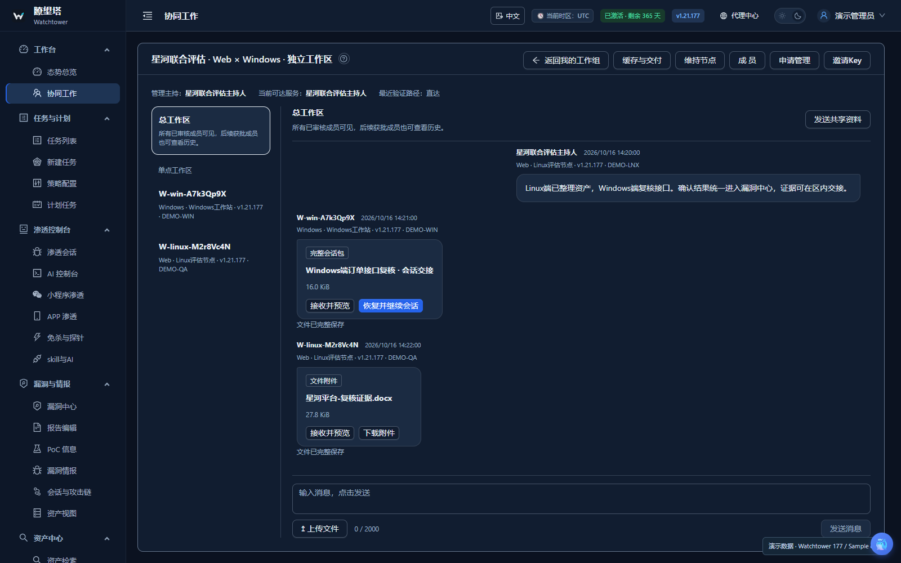
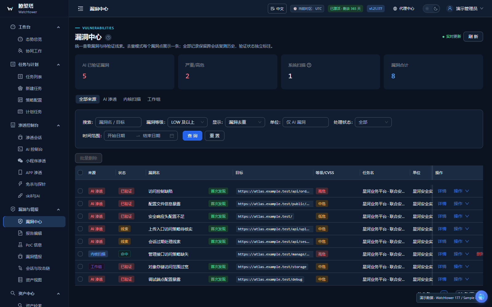
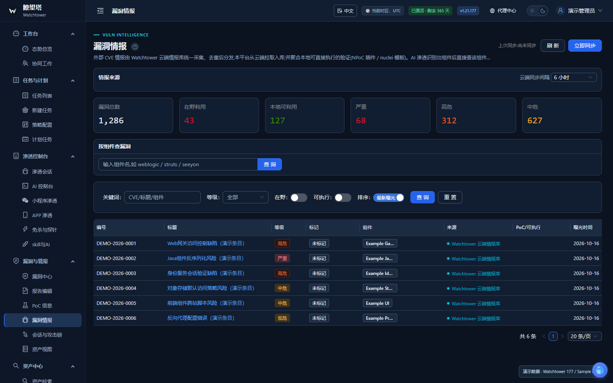
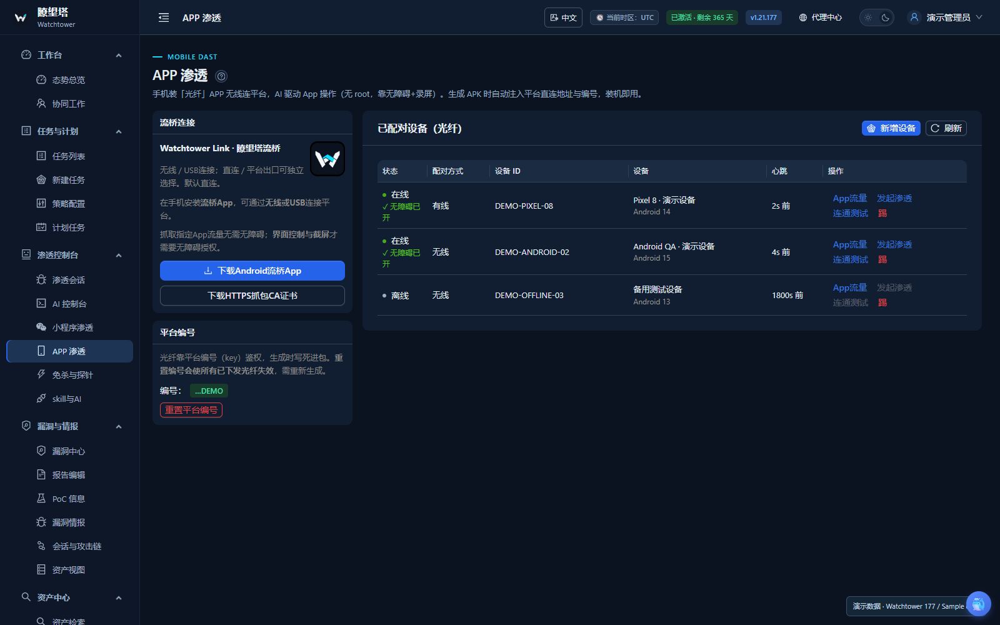
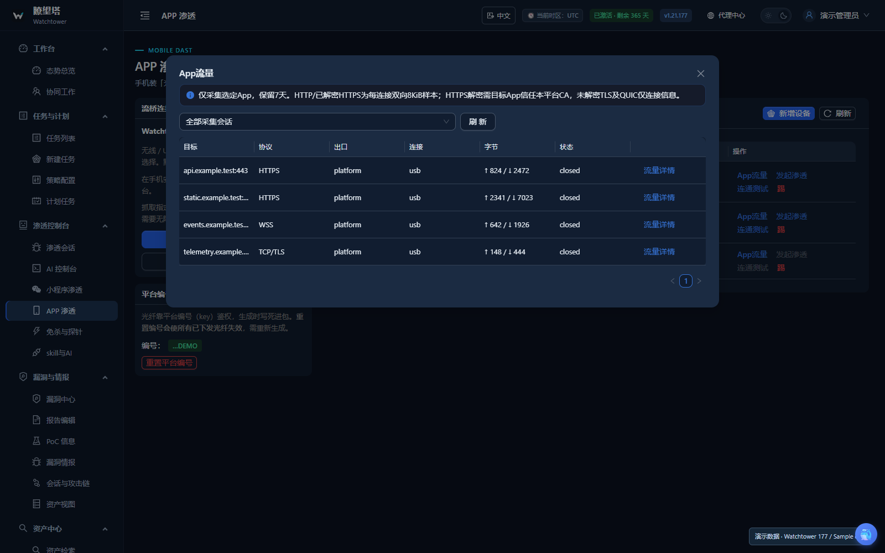
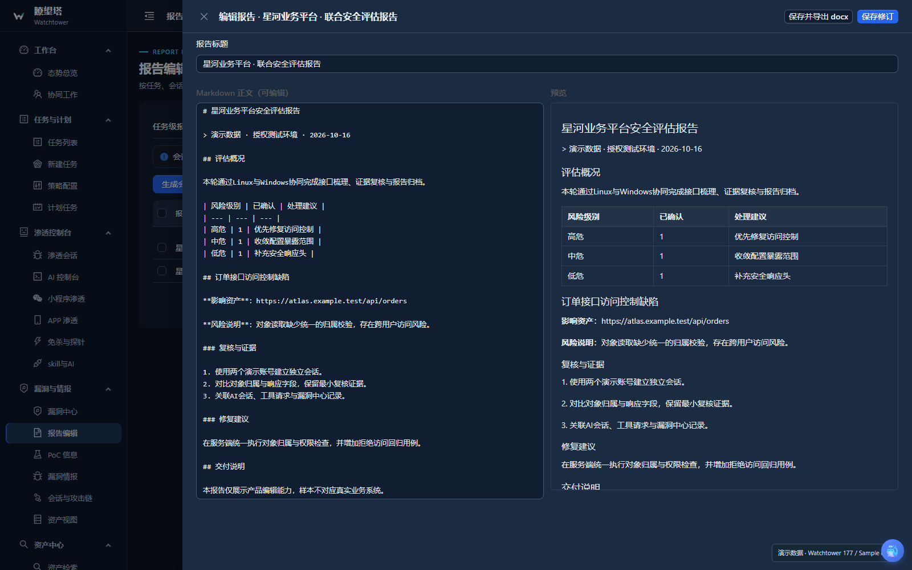
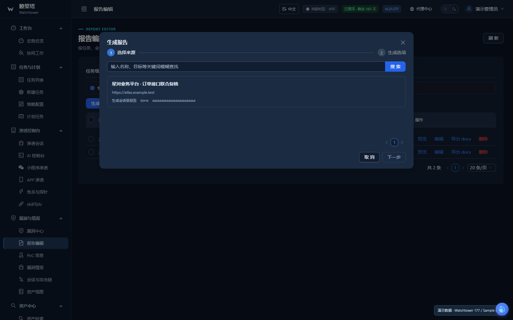
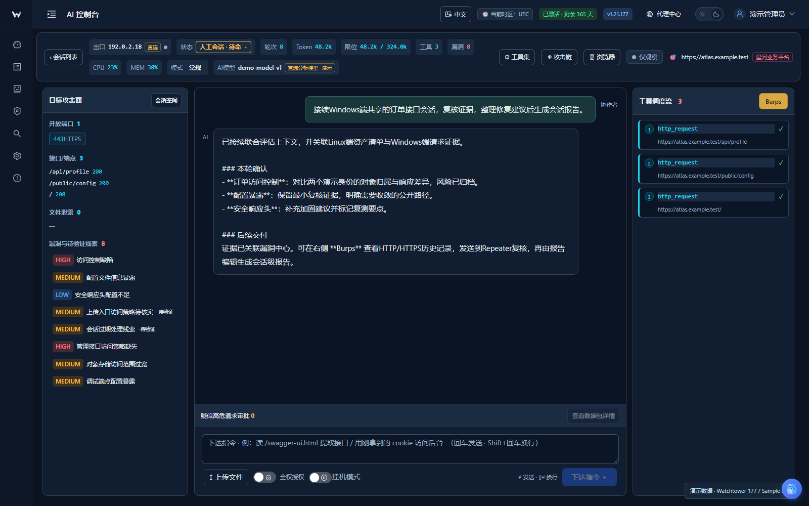
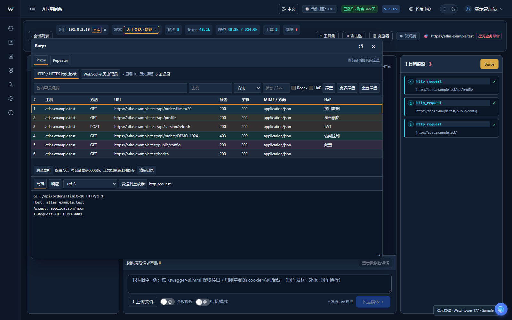
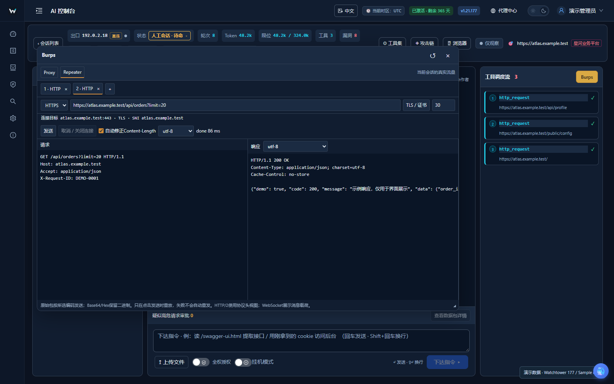

# 瞭望塔 Watchtower

最新补丁：**177B-1**。Windows下载统一弹出系统“另存为”，更新后自动加载新GUI；发现补丁与更新检测显示完整补丁编号。所有包统一在[分发系统](https://watchtowers.info/)下载，GitHub不上传包。

Web与Windows当前正式版本：**v1.21.177**。开发始于2026年6月3日，原创代码采用GPL-3.0-only。

[官网与下载](https://watchtowers.info/) · [版本发布](https://github.com/LINGYK352/Watchtower/releases) · [English](README.en.md)

177提供双端完整新安装基板。既有175/176用户可在更新页沿签名相邻链升级，保留账号、配置、任务、会话和证据；177是新的回退下限。更早Web用户使用官网安装脚本的保数据修复模式。更新前结束关键任务；首次更新控制组件迁移会协调后台进程。

本轮包含独立协同工作区、成员/副主持与区内身份、通用Linux维持节点和密文缓存、数据迁移及附件交付；模型名称与环节匹配的专有SKILL、首选/备用模型与计划任务；原Word模板人工标注/AI学习、统一报告来源选择；会话与分支攻击链、HTTP/HTTPS和WebSocket历史/重放；日夜与窄窗布局、详细叶子手册、本地系统及补丁更新日志。

功能版本与补丁分开管理，后续本轮改动合并为177B-1补丁，主界面隐藏补丁序号。Windows失败的早期本地诊断已包含；新增日志选择上传等未完成项目不计为已交付。Windows11与Linux测试通过所列用例，Windows10、APP真机和所有真实模型/目标组合不作等价实测承诺。

安装与操作请参照官网和系统内“使用手册”。第三方工具/库遵守各自许可；源码与完整运行包不包含运营注册库、真实配置或用户数据。

<!-- watchtower-ui-gallery:start -->
## 功能界面 · 示例数据

以下为177实际界面与隔离示例数据，不对应真实客户、真实设备连接或实际评估结果。安装包和补丁统一在[分发系统](https://watchtowers.info/)下载。

### 01 · 跨端协作

Linux与Windows在独立工作区交接会话、证据与附件。

### 02 · 漏洞中心

统一查看AI渗透、内核扫描与工作组发现，关联验证状态与证据。

### 03 · 公开情报

查看情报来源、风险等级、组件与同步状态，快速筛选相关线索。

### 04 · APP渗透

管理有线与无线设备，连接移动端评估与平台会话。

### 05 · APP流量

按设备查看HTTPS、WebSocket与TCP/TLS流量及请求响应。

### 06 · 报告编辑

直接编辑报告内容并实时预览，整理证据、风险与修复建议。

### 07 · 报告生成

按任务、会话或单个漏洞选择来源，使用Word模板生成交付报告。

### 08 · AI会话台

在同一会话查看上下文、工具调用、关联漏洞与协作接续结果。

### 09 · Burps历史记录

在AI会话台内查看HTTP/HTTPS历史、HaE标记与原始报文。

### 10 · Burps重放

将历史请求送入Repeater，在同一窗口对照请求与响应。

<!-- watchtower-ui-gallery:end -->
