# 瞭望塔 Watchtower

Web与Windows当前正式版本：**v1.21.178**。原创代码GPL-3.0-only。

[官网与下载](https://watchtowers.info/) · [English](README.en.md) · [178更新与修复安装](https://watchtowers.info/)

178合并177全部已发布补丁与本轮修复：Windows下载统一另存为、证书与更新兼容、首次协议签署保持；配对确认/撤销清理、增量同步业务身份合并、内置环节仅覆盖同步及重复清理；旧/迁移会话受闸刀监管的挂机模式与入口；工作区多进程收信租约和独立临时目录修复并发503，后台重连保留消息和草稿；修复重启遮罩鉴权和页面不可点击、Windows99%状态与更新恢复互斥，完整安装器新增保留账号配置/业务资料的修复安装；新建会话模式选中态、多目录ZIP解压后由用户选入口（本地和云端）、未填目标显示未知且继续待命；专有SKILL在同步/流式/后台会话中沿实际模型及环节传给工具，兼容显式备用、网络重试及绑定撤销。

178为双端新安装基板及回退下限。177、177B-1、177B-2直接升级178，保留账号、配置、任务、会话与证据；旧175/176沿既有签名功能链升级。安装包统一由官网分发，Windows支持修复现有安装。Windows10未完成实机验收。

<!-- watchtower-ui-gallery:start -->
## 功能界面 · 示例数据

以下是178系列实际客户端界面的演示截图，包含通过官网更新交付的界面改进。目标、设备、会话、情报和统计值均为示例，不代表真实客户、设备连接、性能测试或评估结果。安装包和更新统一在[官网](https://watchtowers.info/)获取。

### 01 · 跨端工作组

在独立工作区交接消息、完整会话、证据和附件。

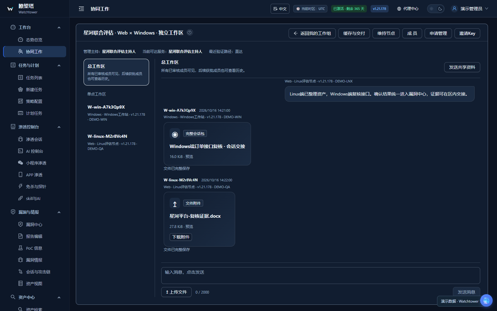

### 02 · AI控制台

在同一会话查看攻击面、工作进展、工具调用与漏洞线索。

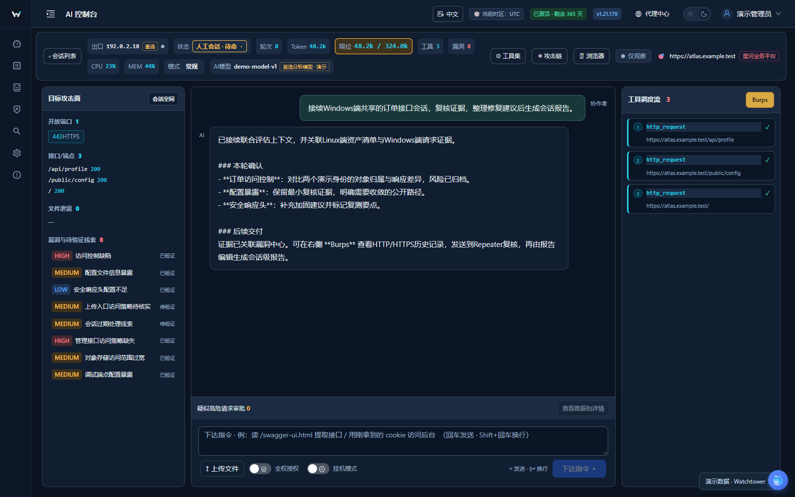

### 03 · Burps流量历史

查看HTTP/HTTPS记录、HaE标签与原始请求响应。

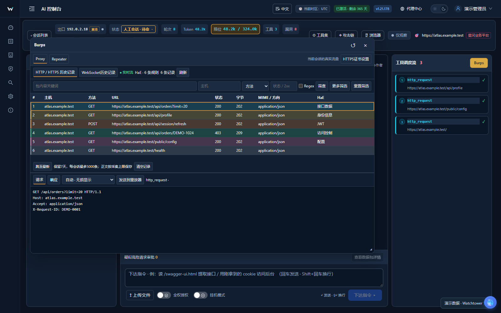

### 04 · Burps重放

把选中的请求发送到Repeater，调整并对照响应。

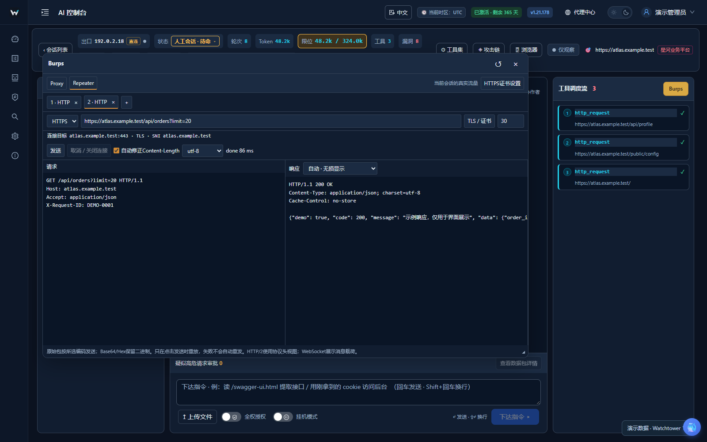

### 05 · APP设备接入

管理USB与无线设备，区分流量采集和无障碍控制权限。

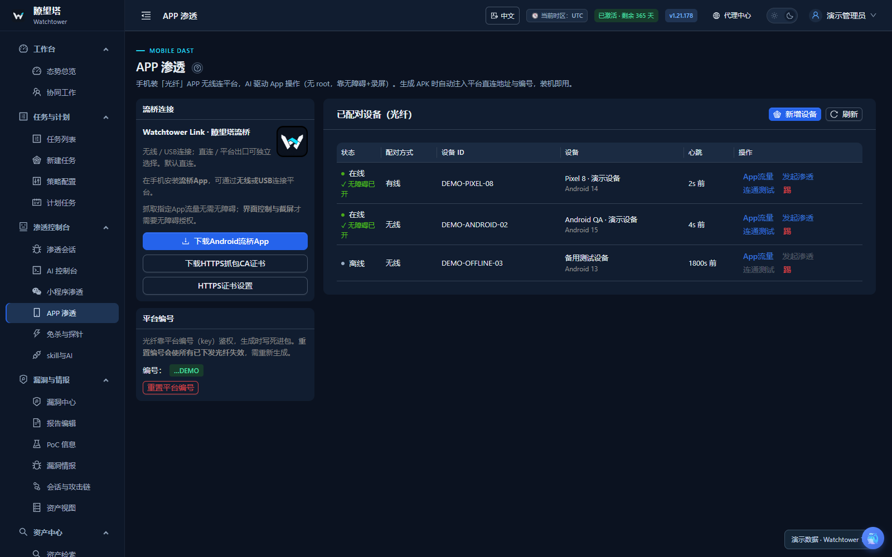

### 06 · APP流量

查看设备业务连接、协议和采集记录；HTTPS解析取决于信任与解码条件。

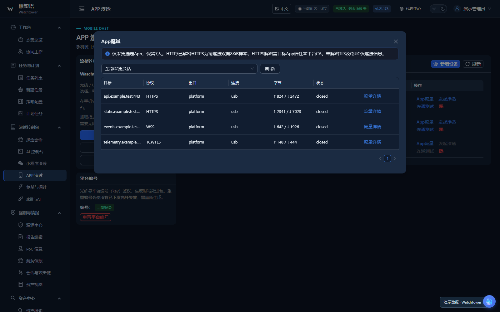

### 07 · 小程序渗透

导入wxapkg主包与子包材料，再按模式和模型发起会话。

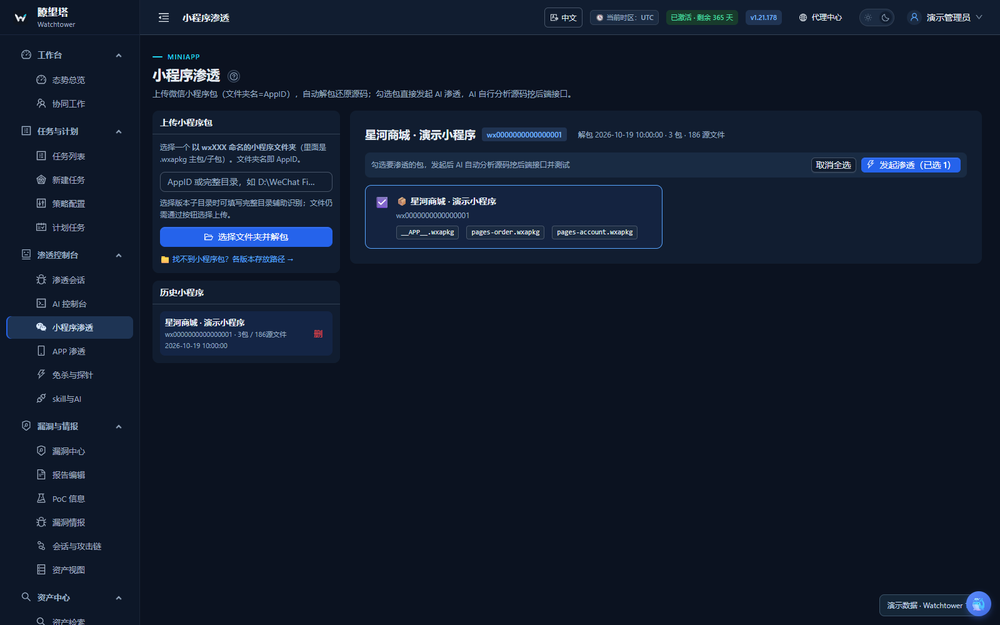

### 08 · 公开情报

按组件、等级和来源检索情报，查看本地可利用与同步状态。

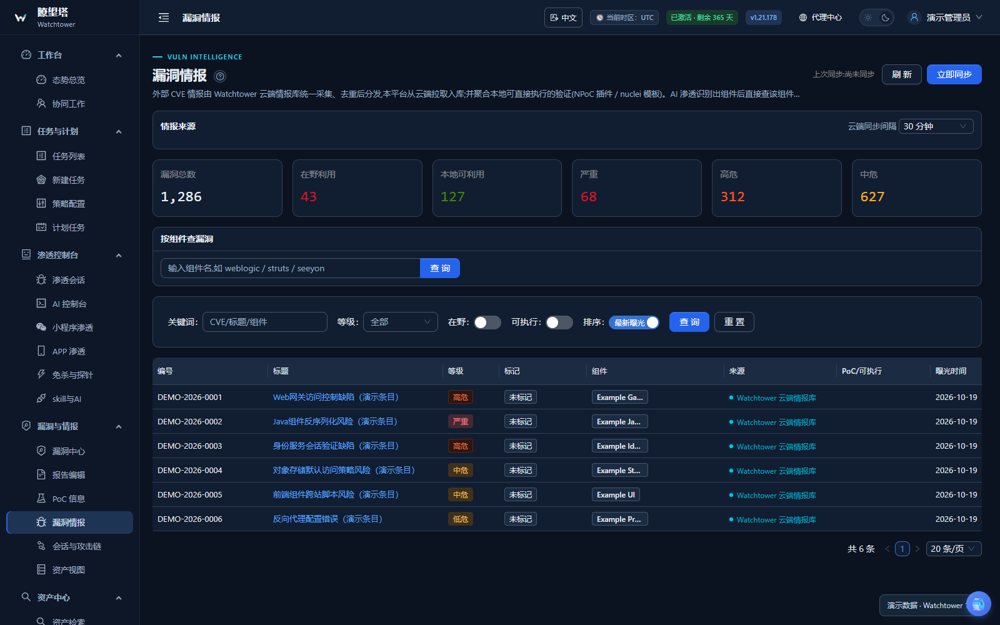

### 09 · 漏洞中心

结合来源、级别和状态管理发现，并回到相应证据复核。

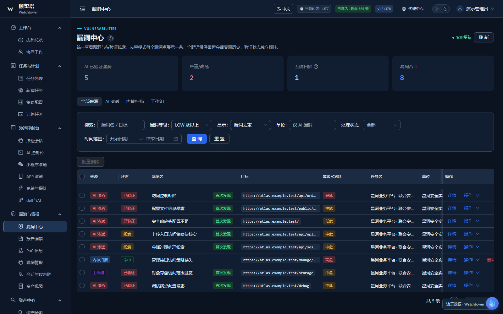

### 10 · 报告编辑

编辑报告内容并预览，整理风险、复核材料与修复建议。

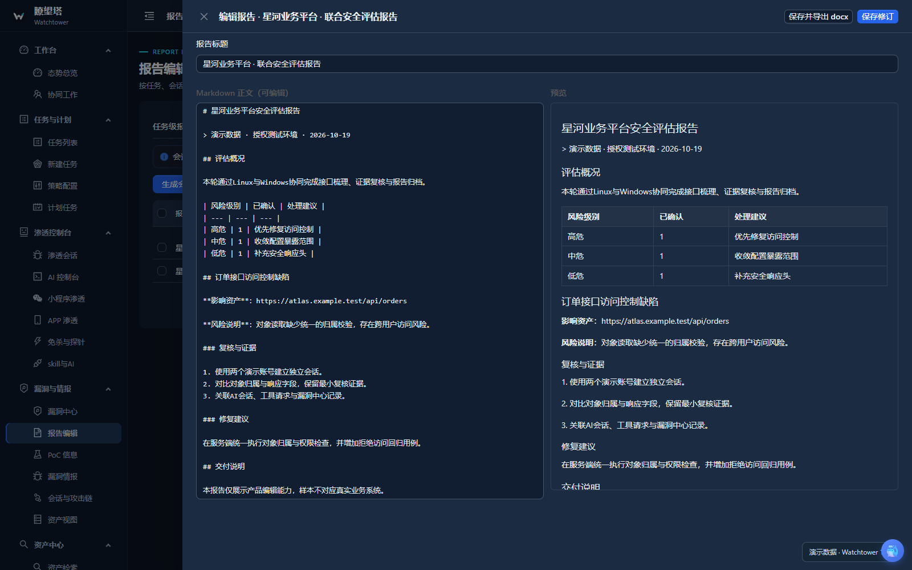

### 11 · 报告生成

搜索和选择会话等来源，再配置相应报告选项。

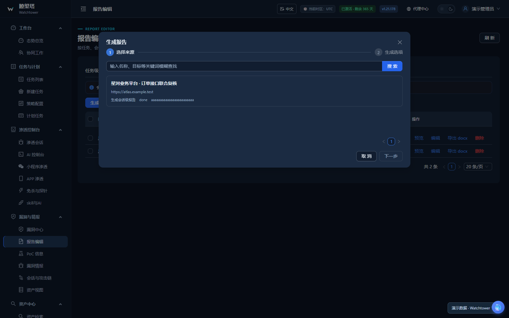

### 12 · 态势总览

集中查看资产、任务、AI会话、Token及资源状态。

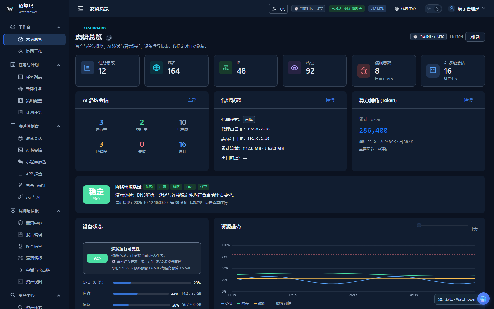

### 13 · 资源水位调控

根据物理内存、预留预算和资源压力估算并发，查看变化趋势。

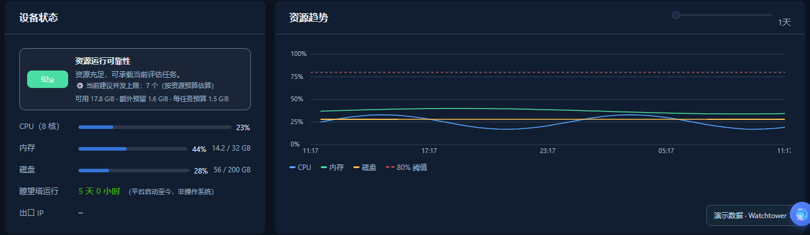

### 14 · 专有SKILL

按模型配置名称、入口文档与任务环节绑定专有SKILL。

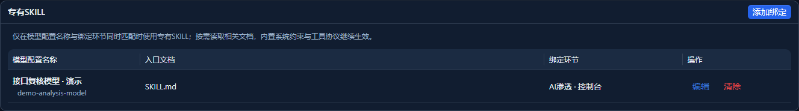

<!-- watchtower-ui-gallery:end -->

## 联系作者

遇到问题可扫码添加我的微信，请附版本号、操作步骤和报错信息。

